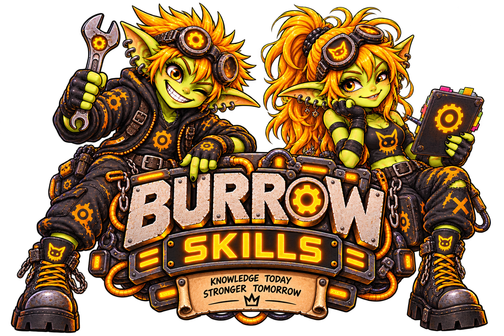

  

# Burrow Skills

Public operating skills for Burrow and its integrations, updated independently of application releases.

## Available

- `burrow-runtime/SKILL.md`: native runtime, tools, continuity, delegation, skills, and verification.
- `goblin-secret-store/SKILL.md`: safe credential discovery and protected-reference use through Goblin Secret Store.
- `burrow-backdoor/SKILL.md`: home-Burrow diagnostics, durable mod administration, and explicitly authorized full local Core API requests through Backdoor.
- `node-goblin-operations/SKILL.md`: pairing, health, updates, recovery, and remote-execution boundaries for Node Goblin.

## Install and update

Current Core and loaded mods provision their declared companion skills automatically. Inspect managed ownership first; do not create a duplicate manual import or try to edit a managed runtime copy.

For an optional manual import on a compatible runtime, open **Settings → Skills** and import repository `https://github.com/GoblinKing-Burrow/Burrow-Skills.git`, ref `main`, and the path to the wanted skill, such as `goblin-secret-store/SKILL.md`. Preview, inspect, then install and enable automatic synchronization with your preferred schedule. Tags and commits pin content instead of following updates.

Skills are source artifacts, so no package build is required. A configured Git source follows its selected ref; complete public promotion still runs at the daily release boundary. Verify the installed revision rather than assuming a development change has reached the public source.

Import never overwrites an existing ID. For an older bundled, non-managed `burrow-runtime`, its source controls may allow Git configuration. Current Core/mod-managed copies use their declared sources and read-only ownership instead. Synchronization preserves assignments for ordinary imported skills; inspect the installed ownership and source status before changing anything.

Text-only skills use PostgreSQL. Select a directory for skills with artifacts so supporting files stay together in runtime filesystem storage. Import and sync do not execute scripts.

## Contributions

Each skill has its own directory with `SKILL.md` and name/description frontmatter. Supporting files belong alongside it. Keep instructions matched to current capabilities and document minimum runtime requirements where needed. Runtime tool schemas remain authoritative: skills cannot grant tools, access, or authorization.

Review contributions for secrets, private infrastructure details, and operator-specific data before publishing. Do not include runtime exports, credentials, conversations, caches, or mirrored application source.

